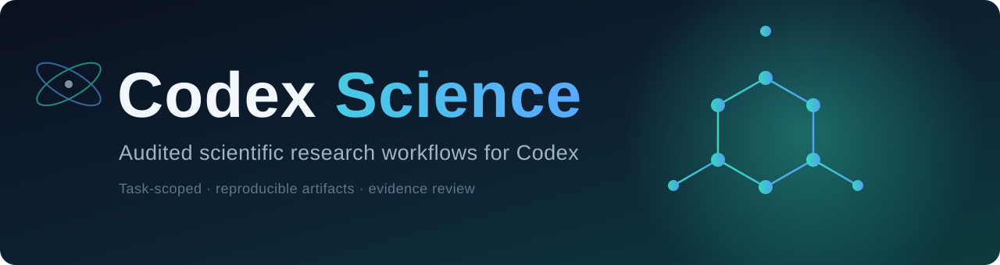

<p align="center">
  
</p>

<p align="center">
  <a href="README.ko.md">한국어</a> ·
  <a href="docs/SETUP.md">Setup</a> ·
  <a href="docs/">Docs</a>
</p>

<p align="center">
  <a href="https://github.com/eightmm/codex-science/actions/workflows/ci.yml"></a>
</p>

Codex Science is an opt-in scientific workbench for Codex tasks. It is an
independent plugin inspired by Claude Science's public workflow and makes no
parity claim about private implementations.

- An audited catalog of 284 skills: 149 K-Dense-AI, 132 Codex-native, and 3
  DeepMind infrastructure pointers.
- 34 read-only public data connectors, plus catalog search and research planning.
- Reproducible run artifacts with independent evidence review.
- Local and remote scientific computing with approval gates.

## Quick start

Install once; the plugin works in every project:

```bash
curl -fsSL https://raw.githubusercontent.com/eightmm/codex-science/main/scripts/install.sh | bash
```

The installer needs `curl`, a Codex CLI, Git, and either `uv` or Python 3.11+.
With `uv`, it records a managed Python 3.12 runtime; on a Python 3.8 system,
install `uv` first. The runtime uses only the standard library. See
[Setup](docs/SETUP.md) for details.

The managed checkout is `~/.codex-science`; the install is user-global.

In a new Codex task, open `/hooks` and trust the `SessionStart`,
`UserPromptSubmit`, and `Stop` hooks once. This is the human security boundary:
it approves the plugin command, while the start phrase activates science mode.
Hook trust is tied to the exact bootstrap definition, so review `/hooks` again
only when that definition changes. Asking Codex to run the hook script manually
is not a substitute for hook trust.

```text
Start Codex Science
Codex Science 시작
```

Stop explicitly with `Stop Codex Science` or `Codex Science 종료`.

For an existing install whose host bootstrap must change, close all Codex tasks
and the app, then use the acknowledged migration command:

```bash
curl -fsSL https://raw.githubusercontent.com/eightmm/codex-science/main/scripts/install.sh | CODEX_SCIENCE_MIGRATION_ACK=all-codex-tasks-closed bash
```

Do not use the acknowledgement while Codex is open. Routine runtime updates
after migration do not need this command.

## Usage

Activation is explicit. An ordinary scientific question in a fresh task does
**not** activate the mode; only three core skills are registered with Codex, and
catalog wrappers load only when the active coordinator selects them.

Continue in the same task with requests such as:

```text
Find recent primary literature for this hypothesis.
Design the smallest experiment that could disprove it.
Analyze these results and record reproducible artifacts.
Review the final claims against the execution record.
```

Agentic life-science examples:

```text
Interpret rs7903146 for type 2 diabetes across FinnGen, BioBank Japan, and UKB/TOPMed.
Prioritize genes at this asthma locus using genetics, eQTL, expression, and pathway evidence.
Find reusable public proteomics and microbiome datasets for this hypothesis, then rank them by study-design fitness.
```

Use an interactive task for turn-by-turn work. For several autonomous
continuations, start a new task with native `/goal` and a concrete contract:

```text
Start Codex Science.
Goal: reproduce the supplied result and write a reviewed report.
Constraints: use public sources and local CPU only; do not install packages.
Done when: tests pass, every claim has saved evidence, and independent review passes.
```

A goal run continues until it is complete, genuinely blocked, or at an approval
gate. It chooses defaults for non-blocking preferences and batches known
decisions into one question. Codex creates the checkpoint automatically; users
do not need to run science_checkpoint.py commands. The checkpoint holds control
metadata only: no prompts, credentials, private data, or conclusions.

Results are saved under `artifacts/<run-id>/`, including `checkpoint.json` and a
local `index.md` (and an offline `index.html` when requested). Primary images
appear inline. Reports, tables, notebooks, logs, and secondary figures are
returned as clickable links; no web deployment is needed. An independent review
checks the recorded evidence. See the [Research Discovery
Loop](docs/RESEARCH_DISCOVERY.md) for new-method development and unexplained
research bottlenecks; its CPU fixtures do not establish general research gains.
The [PheWAS acceptance run](examples/life-science-reviewed-run/) shows a bounded
life-science workflow.

## Scientific computer use and approvals

Codex Science can use local Python, R, Julia, Jupyter, CPU and GPU resources, or
an existing SSH host and Slurm cluster. Remote compute also covers a cloud GPU
account or private object store. GUI and browser desktop automation are outside
this workflow. Read-only inspection and small work in an existing environment
can proceed directly, and approved reversible steps continue without repeated
prompts. Package installation, a new host, private-data transfer, remote job
submission, or paid resources require one approval packet describing target,
data movement, resources, time and cost cap, output path, and cancellation plan.
Credentials are never stored in run artifacts. Commands, environments, job IDs,
logs, exit status, costs, and output hashes are recorded under
`artifacts/<run-id>/`. See [Scientific compute](docs/COMPUTE.md).

## Updates

Set `CODEX_SCIENCE_AUTO_UPDATE` before launching Codex:

| Mode | Session start / first activation | Explicit update |
| --- | --- | --- |
| `apply` (default) | Verify and install a compatible runtime | Install for new activations; keep active runs pinned |
| `notify` | Report only | Install for new activations; keep active runs pinned |
| `off` | Skip | Install for new activations; keep active runs pinned |

Request an update in any mode with `Codex Science 업데이트` or `Update Codex
Science`. Failed checks keep the last-known-good runtime. Use the curl migration
only when the installer requests a host-bootstrap migration or repair. An
active run keeps its runtime pin; open a new task to adopt an installed runtime.
See [Setup](docs/SETUP.md) for update classification and runtime identity.

## Verify and troubleshoot

Check registration with `codex plugin list`; the plugin should be
`installed, enabled`. If activation fails, open a new task, inspect `/hooks`,
trust all three hooks, and say `Start Codex Science`.

### Known limitations

Codex Science does **not** run in the background after the app or task closes.
The Stop hook warns but does not block because of
[openai/codex#20783](https://github.com/openai/codex/issues/20783);
`CODEX_SCIENCE_STOP_MODE=block` is retained only for compatibility testing after
the installed Codex includes the upstream fix; do not enable it while
openai/codex#20783 is reproducible. Do not combine it with another Stop loop. Without all three hooks trusted, same-task continuity is
best effort. `waiting_external` records how to resume; it does not poll while a
task is closed.

## Catalog and data sources

The inventory has three tiers: K-Dense-AI (149), Codex-native (132), and
DeepMind infrastructure pointers (3). Codex-native skills cover the Google
DeepMind science set, textbook-grounded mathematics and physics, statistical
decision analysis, life-science evidence synthesis, spectroscopy and analytical
chemistry, scientific compute, and gated execution workflows for current open
models such as ESMFold2, AlphaFold3, RFdiffusion, and BindCraft. Skills are
audited as active or inactive; inactive skills show their audit reasons and
require acknowledgement before their upstream instructions can be inspected.
The read-only MCP exposes `science_search_*` and `science_plan_*`; the same
tools are available through `scripts/science_tool.py`. See [life-science
source coverage](docs/LIFE_SCIENCE_RESEARCH_SOURCES.md). Catalog presence is not
execution permission.

## Evaluation status

On the frozen six-task literature benchmark, the latest recorded run, Run30,
completed 5/6: standard-mrna stopped on a provider policy block. Across runs
6–30, standard-mrna was blocked by provider policy in 8 of 25 runs. Runs 28 and
29 each completed 6/6. Each run has only six tasks, so these results cannot
establish a trend. See [Evaluation](docs/EVALUATION.md) for run-level evidence
and limits.

## Development

```bash
git clone https://github.com/eightmm/codex-science.git
cd codex-science
./scripts/bootstrap.sh
./scripts/check.sh fast    # offline unit, catalog, plugin, and skill validation
./scripts/doctor.sh        # checkout, submodule, catalog, and environment diagnosis
./scripts/check.sh public  # optional live public-source smoke test
```

`doctor.sh` validates native sources and generated wrappers and pinned source
integrity.

Do not register the development checkout as a Codex marketplace. Install the
runnable plugin with the curl command above; do not run
`codex plugin marketplace add "$PWD"` here.

## License

Codex Science's original code is released under the [MIT License](LICENSE).
Imported and adapted skills retain their upstream licenses: K-Dense-AI skills
retain their per-skill licenses; Google DeepMind skills retain Apache-2.0 and
CC-BY-4.0 attribution, with upstream license records preserved in the pinned
vendor copy; source and license records for public textbooks and
analytical chemistry standards are documented in [Textbook sources](docs/TEXTBOOK_SOURCES.md)
and [Analytical sources](docs/ANALYTICAL_SOURCES.md). Repository-level files do
not override individual skill or dependency licenses.
